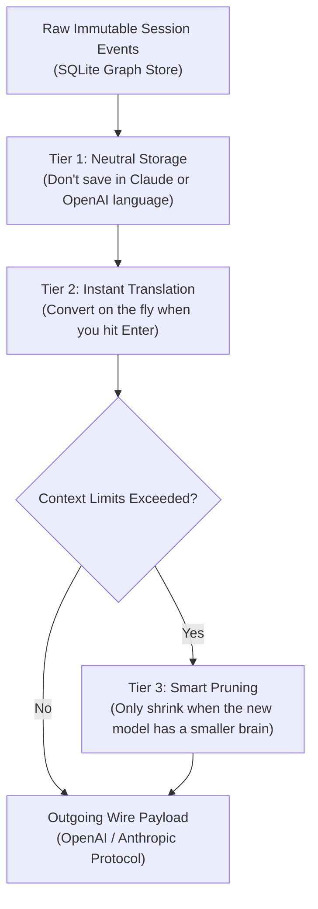

# Cross-Provider Context Handoff

> How Codesh enables switching models and providers mid-session without losing code context, conversation state, or tool results.

## Overview

A common challenge in agentic coding is switching models in the middle of an active conversation—for instance, switching from an expensive reasoning model (`claude-3-7-sonnet` on Anthropic) to a faster, cheaper model (`deepseek-chat` or `gpt-4o-mini` on OpenRouter/OpenAI), or falling back to a local model running on Ollama.

Naive approaches often resort to **summarization**, which strips out line numbers, file paths, exact code snippets, and structured tool returns. 

Codesh solves this using a **3-tier architecture**:

---

## The Meeting Analogy

Think of switching models like handing over an active technical meeting:
- Person A speaks **French** (Anthropic Claude).
- Person B speaks **Spanish** (OpenAI / DeepSeek).

If you want Person B to take over the meeting halfway through, how do you catch them up?
- **The Bad Way (Just Summarizing)**: Someone gives Person B a 2-sentence summary: *"We talked about some bugs in the code."* Person B is completely lost! They don't know the file names, the exact line numbers, or what commands were just tested.
- **The Codesh Way (3-Tier Architecture)**:
  1. A note-taker writes down every word in **Neutral English** (Tier 1: Neutral Database).
  2. The moment Person B walks in, an instant translator reads those neutral notes and translates them into fluent Spanish (Tier 2: Instant Translation).
  3. Only if the notes are too thick to fit in Person B’s small notebook do you neatly condense the older pages while keeping the latest details word-for-word (Tier 3: Smart Pruning).

---

## How the 3 Tiers Work in Codesh

### Tier 1: Neutral Storage (Don't save in "Claude" or "OpenAI" language)
OpenAI and Anthropic format their JSON completely differently.
- If you save chat history in Anthropic’s format, OpenAI will choke on it.
- If you save it in OpenAI's format, Anthropic will reject it.

**So, Codesh saves everything in a plain, neutral format in SQLite ([`src/session/store.ts`](../../src/session/store.ts)):**
- *"User said: X"*
- *"Assistant ran command: Y"*
- *"Command output was: Z"*

Turns are recorded as generic domain entries (`user_message`, `assistant_message`, `tool_call`, `tool_result`). It doesn't care which model said it. It’s just neutral, clean data, and the session is never locked into the provider that originated the turn.

---

### Tier 2: Instant Translation (Convert on the fly when you hit Enter)
When you type your next prompt, [`src/session/context.ts`](../../src/session/context.ts) looks at who you are currently talking to:
- If you are talking to **Claude**, Codesh takes the neutral history and packages it into Anthropic’s exact JSON structure (extracting top-level system blocks and mapping `tool_use`/`tool_result`).
- If you switch to **DeepSeek** or **GPT-4o**, Codesh takes that exact same neutral history and packages it into OpenAI’s JSON structure (`tool_calls` array, function formats).

Because translation happens **on the fly**, you can switch models back and forth 10 times in a single session without breaking anything:
1. **System Prompt Placement**: OpenAI wants system messages inside the `messages` array; Anthropic requires a top-level `system` property with ephemeral prompt cache markers (`cache_control: { type: "ephemeral" }`).
2. **Capabilities Filtering**: If switching from a multi-modal model to a text-only model (e.g. GPT-4o to DeepSeek), [`src/providers/openai-compatible.ts`](../../src/providers/openai-compatible.ts) detects unsupported image blocks and substitutes clean placeholders: `"[Image omitted: model does not support image input]"` to prevent HTTP 400 rejection.
3. **Reasoning Flags**: DeepSeek models fail or waste tokens if reasoning is enabled during tool turns. When projecting turns that contain tool results, the adapter automatically injects `thinking: { type: "disabled" }`.

---

### Tier 3: Smart Pruning (Only shrink when the new model has a smaller brain)
What if you were chatting with Claude (which has a huge **200,000 token limit**), and you switch to a smaller local model that only supports **32,000 tokens**?
- The history is too big for the new model.
- **Instead of throwing away the conversation**, Codesh looks at the history:
  1. **Headroom Compression** ([`src/compression/request-transform.ts`](../../src/compression/request-transform.ts)): Trims huge old terminal outputs (e.g., an 800-line `git diff` from 10 turns ago is shortened to a brief summary).
  2. **Verbatim Working State**: Keeps your latest code edits, file paths, and prompts word-for-word.
  3. **Session Compaction** ([`src/session/compaction.ts`](../../src/session/compaction.ts)): Only if it's *still* too big does it summarize the oldest turns into a structured checkpoint.
  4. **Reactive Overflow Recovery** ([`src/agent/loop.ts`](../../src/agent/loop.ts)): If an upstream provider rejects the payload with a context overflow error (HTTP 400/413), the agent loop catches the error, triggers an emergency compaction pass, and immediately retries the request without crashing.

---

## Key Files

| Path | Responsibility |
| --- | --- |
| [`src/session/store.ts`](../../src/session/store.ts) | Vendor-neutral SQLite conversation store |
| [`src/session/context.ts`](../../src/session/context.ts) | Projects stored entries into canonical model messages |
| [`src/providers/openai-compatible.ts`](../../src/providers/openai-compatible.ts) | Translates canonical messages into OpenAI/DeepSeek wire format |
| [`src/providers/anthropic.ts`](../../src/providers/anthropic.ts) | Translates canonical messages into Anthropic Messages API format |
| [`src/compression/request-transform.ts`](../../src/compression/request-transform.ts) | Headroom-lite tool output pruning before provider handoff |
| [`src/session/compaction.ts`](../../src/session/compaction.ts) | Compaction and summarization for context window overflow |

## Invariants

- Never store provider-specific wire schemas in the session database.
- Preserve verbatim code diffs, file paths, and recent instructions across provider transitions.
- Dynamically format tool calls and system instructions during projection rather than modifying historical turns.
- Use compaction only when the target provider's context window requires it.
