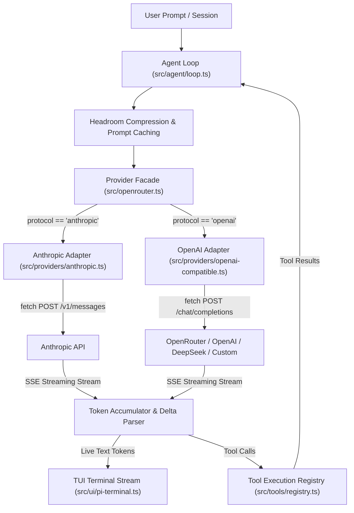

# How Things Work Under the Hood

> A deep dive into Codesh's internal execution pipeline, network transport, protocol adapters, streaming parser, and tool loop.

## Overview

Codesh coordinates real repository work through a local-first agent loop. Rather than relying on heavyweight external SDKs or gRPC, it uses a lightweight, resilient HTTP streaming layer with native `fetch` and Server-Sent Events (SSE).

The following diagram illustrates how user requests travel through the runtime, reach external LLM endpoints, stream tokens back to the terminal, and execute approved tools.

## Execution Flow

---

## Step-by-Step Breakdown

### 1. User Prompt & Session Orchestration
- When you submit a prompt in the interactive TUI or headless CLI, [`src/interactive-session-controller.ts`](../../src/interactive-session-controller.ts) receives the input.
- Messages are projected from the SQLite graph store ([`src/session/store.ts`](../../src/session/store.ts)) into normalized model messages via [`src/session/context.ts`](../../src/session/context.ts).

### 2. Context Compression (Headroom) & Prompt Caching
- Before any request touches the network, [`src/compression/request-transform.ts`](../../src/compression/request-transform.ts) runs **Headroom-lite compression**.
- Large previous tool outputs (e.g., extensive file reads, multi-line diffs, command stdout) are trimmed to preserve the model's context window, while remaining retrievable locally.
- Ephemeral prompt cache markers (`cache_control: { type: "ephemeral" }`) are injected onto system prompts and the latest user turn for endpoints supporting prompt caching (e.g., Anthropic, OpenRouter).

### 3. Provider Facade & Protocol Adapters
- [`src/openrouter.ts`](../../src/openrouter.ts) acts as the unified provider facade. Based on the selected provider configuration (`protocol`), it routes requests to:
  - **OpenAI-Compatible Adapter** ([`src/providers/openai-compatible.ts`](../../src/providers/openai-compatible.ts)): Translates calls into standard OpenAI wire format (`/chat/completions`) with JSON schema tools. Handles OpenRouter, OpenAI, DeepSeek, GLM, Groq, Ollama, and custom endpoints. Includes automatic fallback if a model rejects optional fields like `stream_options` or `tool_choice`.
  - **Anthropic Adapter** ([`src/providers/anthropic.ts`](../../src/providers/anthropic.ts)): Directly formats requests for Anthropic's `/v1/messages` endpoint, extracting top-level system blocks and mapping tools to Anthropic's `{ name, description, input_schema }` format.

### 4. Transport: HTTP + SSE vs. gRPC
- **Standard HTTP**: Calls use Node's native `fetch()` over HTTPS with standard JSON payloads (`Content-Type: application/json`).
- **No gRPC**: gRPC (Google Remote Procedure Calls) uses HTTP/2 with Protocol Buffers (protobuf) binary serialization. While useful for high-throughput internal microservices, major LLM endpoints standardize on HTTP REST + JSON. Using native HTTP avoids heavy binary dependencies like `@grpc/grpc-js` and keeps requests inspectable.
- **Server-Sent Events (SSE)**: The API response stream is parsed as SSE chunks (`data: {...}\n\n`).

### 5. Streaming Token Accumulator & Delta Parser
- The streaming reader processes chunks in real time as they arrive over the wire:
  - **Text Deltas**: Immediately forwarded to [`src/ui/pi-terminal.ts`](../../src/ui/pi-terminal.ts) to display live markdown text in the terminal.
  - **Tool Call Deltas**: Function names and JSON argument fragments are accumulated into complete tool call structures.
  - **Usage & Cost**: Token counts (prompt, completion, cache hits/misses) and cost metadata are parsed to update the telemetry footer.

### 6. Tool Execution & Turn Loop
- If the model requests tool calls, the agent loop intercepts them.
- Permissions are verified through [`src/permissions.ts`](../../src/permissions.ts) before any dangerous disk or shell actions execute.
- Approved tools run via [`src/tools/registry.ts`](../../src/tools/registry.ts).
- Tool results are appended to the conversation history as `role: "tool"` messages, and the loop calls the API again until the model returns a final text response.

---

## Key Paths

| Path | Responsibility |
| --- | --- |
| [`src/agent/loop.ts`](../../src/agent/loop.ts) | Turn loop, tool calling sequence, overflow recovery, and usage accumulation |
| [`src/compression/request-transform.ts`](../../src/compression/request-transform.ts) | Headroom-lite context pruning before model requests |
| [`src/openrouter.ts`](../../src/openrouter.ts) | Unified model and tool completion facade |
| [`src/providers/openai-compatible.ts`](../../src/providers/openai-compatible.ts) | OpenAI / OpenRouter / DeepSeek HTTP SSE adapter with payload fallback |
| [`src/providers/anthropic.ts`](../../src/providers/anthropic.ts) | Anthropic Messages API HTTP SSE adapter |
| [`src/tools/registry.ts`](../../src/tools/registry.ts) | Tool schemas, parameter validation, and execution dispatcher |
| [`src/permissions.ts`](../../src/permissions.ts) | Approval checks and permission state for dangerous tools |
| [`src/ui/pi-terminal.ts`](../../src/ui/pi-terminal.ts) | Terminal UI streaming and interactive components |

## Invariants

- Never require external binary transport libraries (like gRPC) for standard LLM completions; keep the HTTP layer self-contained with native `fetch`.
- Stream text deltas immediately to the UI layer to maintain responsive terminal output.
- Always validate tool calls through the permission engine before execution.
- Maintain transparent fallback handling when upstream providers reject experimental or optional parameters.
